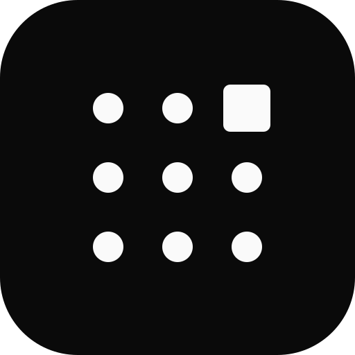

# gridity

Arrange PDF pages, video frames, GIF/APNG frames and images into labeled grid sheets,
sized so an LLM can understand many pages or moments from a single image.

```sh
gridity probe report.pdf                          # pages, sizes, sheet estimates, text size
gridity probe report.pdf --per-page               # which pages need to be seen
gridity render report.pdf                         # prints absolute paths of the sheets
gridity render report.pdf --pages 3-8 --json      # manifest with cell coordinates
gridity render report.pdf --pages 7 --crop 0,0.5,1,0.5   # close-up of the bottom half
gridity render talk.mp4 --start 1:00 --end 2:30 --every 10s
gridity render screenshots/ --cols 3
gridity render report.pdf --pages 7 --ruler       # read --crop values off the sheet
gridity export report.pdf --pages 7 --crop 0.1,0.55,0.8,0.3 -o fig.png   # one file per item
gridity guide                                     # documentation for agents
```

Sheets fit Claude's vision limits without downscaling (`--preset compat`: 1568 px /
1568 visual tokens, `--preset hires`: 2576 px / 4784 tokens), and items are split
evenly across sheets when they do not fit on one.

## Install

```sh
npx gridity --help             # prebuilt: macOS and Linux (x64, arm64), Windows (x64)
cargo binstall gridity         # same prebuilt binaries, installed like cargo install
cargo install gridity          # build from crates.io with Rust
cargo install --path .         # build this checkout
```

Video input needs `ffmpeg` and `ffprobe` on `PATH` (`brew install ffmpeg`), or
`--ffmpeg` / `GRIDITY_FFMPEG`. PDFs, images, GIF and APNG need nothing else.

## MCP server

`gridity mcp` exposes `render`, `probe` and `guide` as Model Context Protocol
tools; `render` returns the sheets as images.

```sh
claude mcp add gridity -- gridity mcp             # installed gridity
claude mcp add gridity -- npx -y gridity mcp      # without installing
```

See `gridity guide mcp` for other clients, parameters and limits.

## Documentation

`gridity guide [topic]` prints the bundled guide (`docs/guide/*.md`):
`recipes`, `pdf`, `pages`, `video`, `images`, `layout`, `output`, `mcp`. JSON Schemas of
every JSON output are in [`docs/schema/`](docs/schema/).

## License

gridity is licensed under either of

- Apache License, Version 2.0 ([`LICENSE-APACHE`](LICENSE-APACHE))
- MIT license ([`LICENSE-MIT`](LICENSE-MIT))

at your option.

Labels use the embedded BIZ UDGothic font, licensed under the SIL Open Font License 1.1
([`assets/fonts/OFL.txt`](assets/fonts/OFL.txt)).

Unless you explicitly state otherwise, any contribution intentionally submitted for
inclusion in gridity by you, as defined in the Apache-2.0 license, shall be dual licensed
as above, without any additional terms or conditions.
